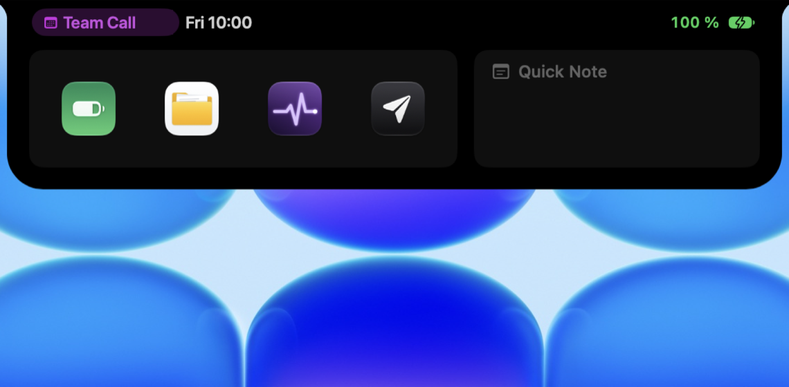

# MacIsland – Dynamic Island for the MacBook Notch

Turns the MacBook notch into a Dynamic Island with music controls, a file shelf with AirDrop, calendar, battery status, quick notes and app shortcuts. A free alternative to NotchNook and boring.notch.

**Download:** [latest release](../../releases/latest) → unzip, move MacIsland to Applications. On first launch right-click → Open (the app is not notarized).

**Build:** macOS 14.2+, Xcode Command Line Tools → `./build_app.sh`

Feedback and ideas are welcome – just open an [issue](../../issues).

MIT License © sami_i04

---
notchnook alternative, boring notch alternative, dynamic island mac, macbook notch, notch app, notch shelf, airdrop, media controls, menu bar, swift, macos
